# DO2_Linux Network (allarosb)

## Содержание
1. [Инструмент ipcalc](#часть-1-инструмент-ipcalc)
    1) [Сети и маски](#11-сети-и-маски)
    2) [localhost](#12-localhost)
    3) [Диапазоны и сегменты сетей](#13-диапазоны-и-сегменты-сетей)
2. [Статистическая маршрутизация между двумя машинами](#часть-2-статическая-маршрутизация-между-двумя-машинами)
    1) [Добавление статического маршрута вручную](#21-добавление-статического-маршрута-вручную)
    2) [Добавление статического маршрута с сохранением](#22-добавление-статического-маршрута-с-сохранением)
3. [Утилита iperf3](#часть-3-утилита-iperf3)
    1) [Скорость соединения](#31-скорость-соединения)
    2) [Утилита iperf3](#32-утилита-iperf3)
4. [Сетевой экран](#часть-4-сетевой-экран)
    1) [Утилита iptables](#41-утилита-iptables)
    2) [Утилита nmap](#42-утилита-nmap)
5. [Статическая маршрутизация сети](#часть-5-статическая-маршрутизация-сети)
    1) [Настройка адресов машин](#51-настройка-адресов-машин)
    2) [Включение переадресации IP-адресов](#52-включение-переадресации-ip-адресов)
    3) [Установка маршрута по умолчанию](#53-установка-маршрута-по-умолчанию)
    4) [Добавление статических маршрутов](#54-добавление-статистических-маршрутов)
    5) [Построение списка маршрутизаторов](#55-построение-списка-маршрутизаторов)
    6) [Использование протокола ICMP при маршрутизации](#56-использование-протокола-icmp-при-маршрутизации)
6. [Динамическая настройка IP с помощью DHCP](#часть-6-динамическая-настройка-ip-с-помощью-dhcp)
7. [NAT](#часть-7-nat)
8. [Дополнительно. Знакомство с SSH Tunnels](#часть-8-дополнительно-знакомство-с-ssh-tunnels)

 

## Часть 1. Инструмент ipcalc
- Запускаем машину (`ws1`) вновь

### 1.1. Сети и маски
1) Адрес сети `192.167.38.54/13`
    - Чтоб определить адрес сети `192.167.38.54/13` используем команду:

            ipcalc 192.167.38.54/13

    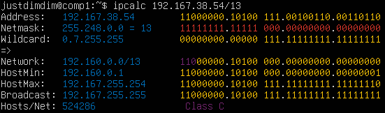
    > По данному скриншоту видно, что адрес сети `192.167.38.54/13`: `192.160.0.0/13`

2) Перевод маски `255.255.255.0` в префиксную и двоичную запись, `/15` в обычную и двоичную, `11111111.11111111.11111111.11110000` в обычную и префиксную
    - Чтоб перевести маску `255.255.255.0` в префиксную и двоичную записи, используем команду:

            ipcalc 192.167.38.54/255.255.255.0

    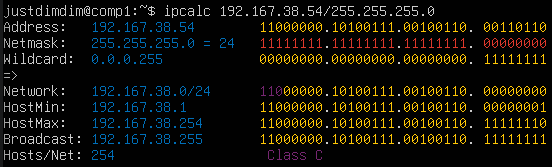
    > По данному скриншоту видно, что префиксная запись маски `255.255.255.0`: `/24`, а двоичная: `11111111.11111111.11111111.00000000`

    - Чтоб перевести маску `/15` в обычную и двоичную записи, используем команду:

            ipcalc 192.167.38.54/15

    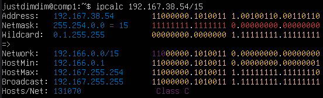
    > По данному скриншоту видно, что обычная запись маски `/15`: `255.254.0.0`, а двоичная: `11111111.11111110.00000000.00000000`

    - Чтоб перевести маску `11111111.11111111.11111111.11110000` в обычную и префекснусю записи, подбором находим обычную запись и используем команду

            ipcalc 192.167.38.54/<обычная запись маски>

    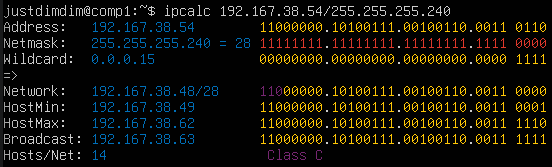
    > По данному скриншоту видно, что обычная запись маски `11111111.11111111.11111111.11110000`: `255.255.255.240`, а префиксная: `/28`

3) Минимальный и максимальный хост в сети `12.167.38.4` при масках: `/8`, `11111111.11111111.00000000.00000000`, `255.255.254.0` и `/4`
    - Чтоб узнать минимальный и максимальный хост сети `12.167.38.4` при определенных масках:

            ipcalc 12.167.38.4/<маска>

    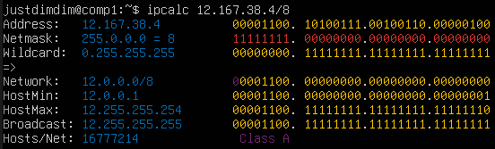
    > По данному скриншоту видно, что минимальный хост маски `/8`: `12.0.0.1`, а максимальный: `12.255.255.254`

    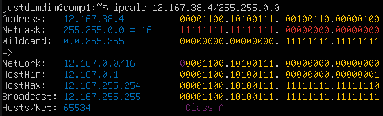
    > По данному скриншоту видно, что минимальный хост маски `11111111.11111111.00000000.00000000` (`255.255.0.0`): `12.167.0.1`, а максимальный: `12.167.255.254`

    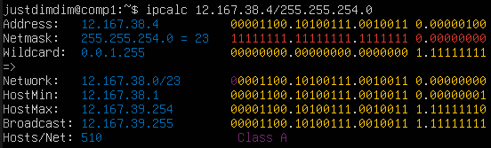
    > По данному скриншоту видно, что минимальный хост маски `255.255.254.0`: `12.167.38.1`, а максимальный: `12.167.39.254`

    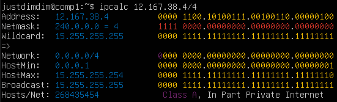
    > По данному скриншоту видно, что минимальный хост маски `/4`: `0.0.0.1`, а максимальный: `15.255.255.254`

### 1.2. localhost
- Чтоб определить, можно ли обратиться с данными `IP` к приложению, работающему на `localhost`, нужно вспомнить, что `IP`, с которыми можно обратиться к `localhost`, должны иметь первый октет - `127`. Таким образом:
    - можно обратиться:
        - `127.0.0.2`
        - `127.1.0.1`
    - нельзя обратиться:
        - `194.34.23.100`
        - `128.0.0.1`

### 1.3. Диапазоны и сегменты сетей
1) Какие из перечисленных IP можно использовать в качестве публичного, а какие только в качестве частных: `10.0.0.45`, `134.43.0.2`, `192.168.4.2`, `172.20.250.4`, `172.0.2.1`, `192.172.0.1`, `172.68.0.2`, `172.16.255.255`, `10.10.10.10`, `192.169.168.1`
    - Перед определением публичности `IP` вспомним частные диапазоны по стандарту `RFC 1918`:
        |Класс|Диапазон|Маска|Префекс|
        |-----|:-------------------------:|:---------:|------:|
        |A|10.0.0.0-10.255.255.255|255.0.0.0|/8|
        |B|172.16.0.0-172.31.255.255|255.240.0.0|/12|
        |C|192.168.0.0-192.168.255.255|255.255.0.0|/16|
        > `IP`, не входящие в эти диапазоны, можно использовать в качестве публичных

    - Таким образом,
        - `10.0.0.45` входит в частный диапазон класса `A`, соответственно, это `частный адрес`
        - `134.43.0.2` не входит в частные диапазоны, соответственно, это `публичный адрес`
        - `192.168.4.2` входит в частный диапазон класса `C`, соответственно, это `частный адрес`
        - `172.20.250.4` входит в частный диапазон класса `B`, соответственно, это `частный адрес`
        - `172.0.2.1` не входит в частные диапазоны, соответственно, это `публичный адрес`
        - `192.172.0.1` не входит в частные диапазоны, соответственно, это `публичный адрес`
        - `172.68.0.2` не входит в частные диапазоны, соответственно, это `публичный адрес`
        - `172.16.255.255` входит в частный диапазон класса `B`, соответственно, это `частный адрес`
        - `10.10.10.10` входит в частный диапазон класса `A`, соответственно, это `частный адрес`
        - `192.169.168.1` входит в частные диапазоны, соответственно, это `публичный адрес`

2) Какие из перечисленных IP-адресов шлюза возможны у сети `10.10.0.0/18`: `10.0.0.1`, `10.10.0.2`, `10.10.10.10`, `10.10.100.1`, `10.10.1.255`
    - Чтоб определить, какие из перечисленных `IP`-адресов шлюза возможны у сети `10.10.0.0/18`, определим диапазон возможных адресов для данной сети с помощью команды:

            ipcalc 10.10.0.0/18
    
    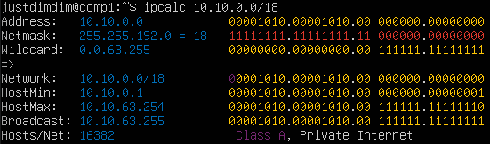
    > По данному скриншоту можно определить, что диапазон возможных адресов: `10.10.0.1`-`10.10.63.254`

    - Таким образом,
        - возможные сети
            - `10.10.0.2`
            - `10.10.10.10`
            - `10.10.1.255`
        - невозможные сети
            - `10.0.0.1`
            - `10.10.100.1`
    
 

## Часть 2. Статическая маршрутизация между двумя машинами
- Создаем новую машину (`ws2`) по тому же принципу, что и в проекте `D01_Linux` и запускаем ее

- На каждой из двух машин запускаем команду:

        ip a

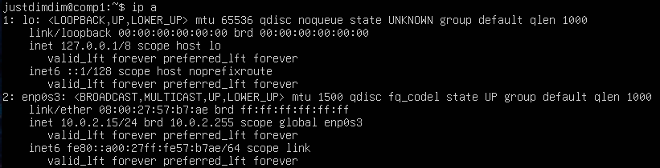
> Результат команды `ip a` на машине `ws1`

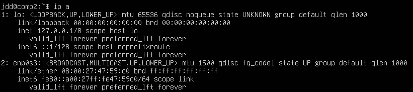
> Результат команды `ip a` на машине `ws2`

- Сетевой интерфейс, соответствующий внутренней сети, на обеих виртуальных машинах — `enp0s3`.

- Чтоб задать внутренней сети соответствующие адреса, меняем соответствующий файл с помощью команды:

        sudo nano /etc/netplan/00-installer-config.yaml

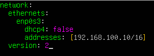
> Результат изменений файла в `ws1`

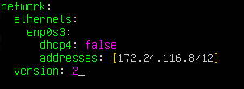
> Результат изменений файла в `ws2`

- Перезапустим сервис сети с помощью команды

        netplan apply
    

> Результат команды `netplan apply` на машине `ws1`

> Результат команды `netplan apply` на машине `ws2`

### 2.1. Добавление статического маршрута вручную
- Чтобы добавить статистический маршрут от одной машины к другой используем команду

        ip r add <ip-адрес нужной машины> dev enp0s3

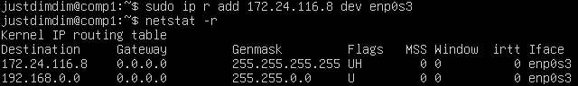
> Результат вышеупомянутой команды на машине `ws1` (с проверкой через `netstat -r`)

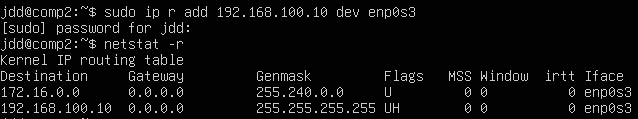
> Результат вышеупомянутой команды на машине `ws2` (с проверкой через `netstat -r`)

- Пингуем соединения с помощью команды:

        ping -w 3 <ip-аднем нужной машины>

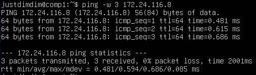
> Пинг соединения на машине `ws1`

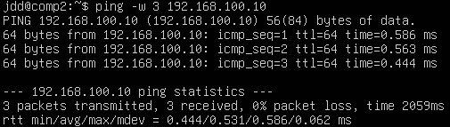
> Пинг соединения на машине `ws2`

### 2.2. Добавление статического маршрута с сохранением
- Перезапусаем обе машины, используя команду:

        sudo reboot
    
- Меняем конфигурационный файл с помощью команды

        sudo nano /etc/netplan/00-installer-config.yaml

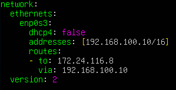
> Результат изменения файла на машине `ws1`

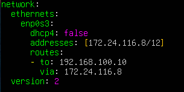
> Результат изменения файла на машине `ws2`

- Пингуем соединения с помощью команды:

        ping -w 3 <ip-адрес нужной машины>

> Пинг соединения на машине `ws1`

> Пинг соединения на машине `ws2`

 

## Часть 3. Утилита iperf3

### 3.1. Скорость соединения
- Переводим значения в другие величины:
    - 8 Mbps = 9 MB/S
    - 100 MB/S = 800000 Kbps
    - 1 Gbps = 1000 Mbps

### 3.2. Утилита iperf3
- Перед тем, как мы измерим скорость соединения между `ws1` и `ws2`, мы создадим сервер на `ws1`, используя команду:

        iperf3 -s

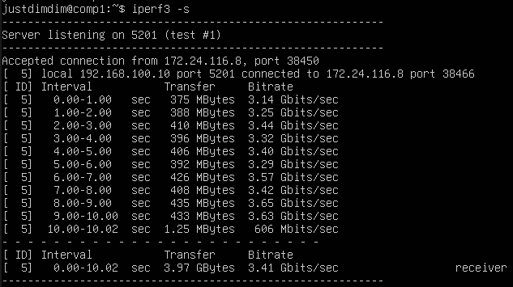
> Результат команды `iperf3 -s` на машине `ws1`

- Затем создадим клиента на `ws2`, делающего запрос на созданный ранее сервер:

        iperf3 -c 192.168.100.10

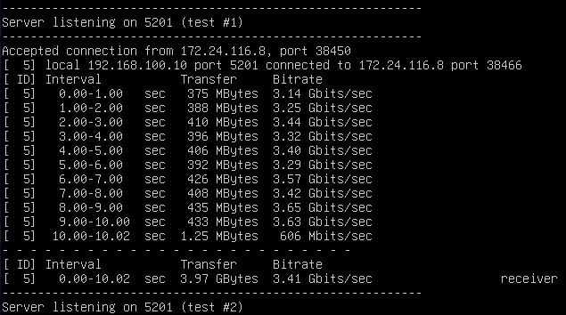
> Результат команды `iperf -c 192.168.100.10` на машине `ws2`

- По скриншотам можем увидеть скорость соединения между `ws1` и `ws2`:
    - sender: `3.42 Gbits/sec`
    - receiver: `3.41 Gbits/sec`

 

## Часть 4. Сетевой экран

### 4.1. Утилита iptables
- На обеих машинах создаем файл `/etc/firewall.sh`, имитирующий файрволл, используя команду:

        sudo nano /etc/firewall.sh

- И следуя заданным правилам отредактируем этот файл на обеих машинах

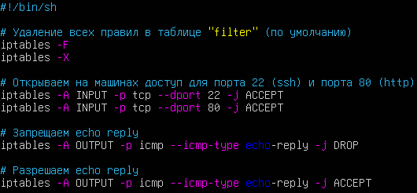
> Результат редактирования на машине `ws1`

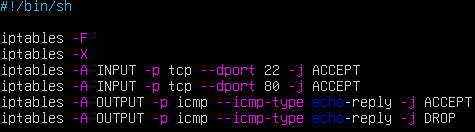
> Результат редактирования на машине `ws2`

- Запустим файлы на обеих машинах командами:
        
        chmod +x /etc/firewall.sh
        ./etc/firewall.sh

- А затем посмотрим на применение примненных правил с помощью команды

    sudo iptables -L -nv

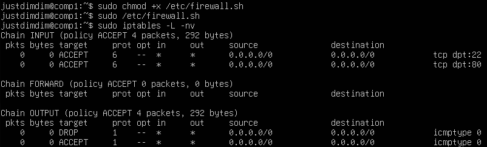
> Результат выполнения данных команд на машине `ws1`

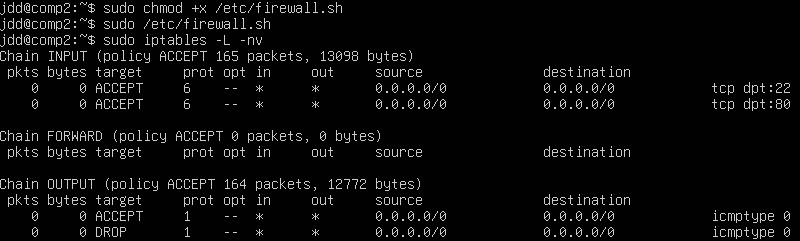
> Результат выполнения данных команд на машине `ws2` 

### 4.2. Утилита nmap
- Определим не "пингующуюся" машину командой:

        ping -c 4 <ip-адрес другой машины>

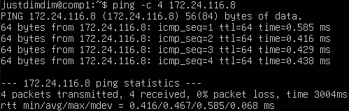
> `0% packet loss` - `ws2` пингуется

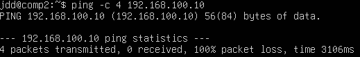
> `100% packet loss` - `ws1` не пингуется

- Перед использованием команды `nmap` скачаем соответствующий пакет:

        sudo apt install nmap
    
- Теперь используем команду:

        nmap 192.168.100.10

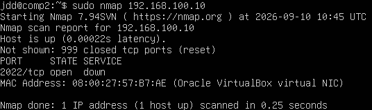
> Результат использования команды на `ws2`

 

## Часть 5. Статическая маршрутизация сети
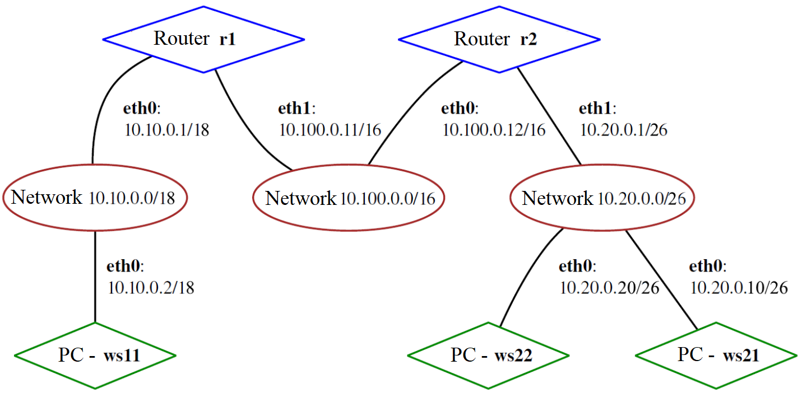
> Устройство сети

- Создадим 5 соответствующих виртуальных машин

> Новые виртуальные машины

### 5.1. Настройка адресов машин
- Модернизируем конфигурационный файл на машинах через команду:

        sudo nano etc/netplan/00-installer-config.yaml

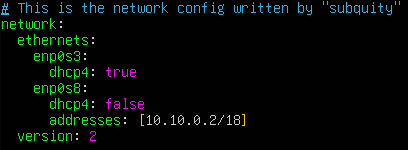
> На машине `ws11`

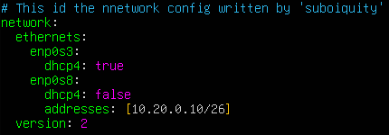
> На машине `ws21`

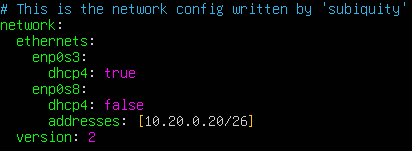
> На машине `ws22`

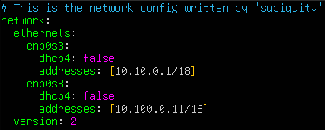
> На машине `r1`

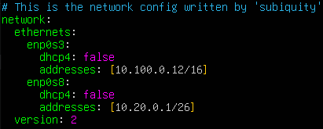
> На машине `r2`

- Чтоб порт `enp0s8` работал, в настройках каждой машины добавляем новый сетевой адаптер, например, типа `"Внутренняя сеть"`

- Сохраняем изменения в `netplan` с помощью команды

        sudo netplan aplly

- Затем проверяем адреса сетевых интерфейсов машины командой

        sudo ip -4 a

> `-4` - вывод только IPv4-адресов

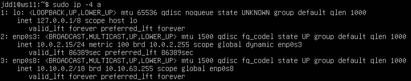
> Вывод команды на `ws11`

> Вывод команды на `ws21`

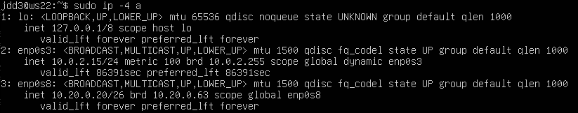
> Вывод команды на `ws22`

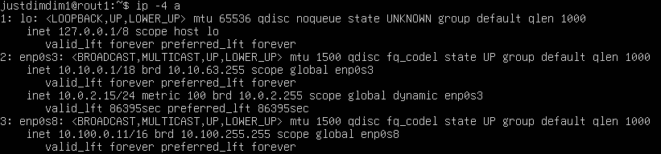
> Вывод команды на `r1`

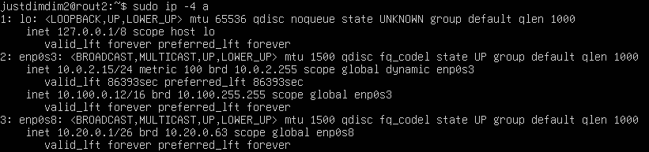
> Вывод команды на `r2`

- Пропингуем `ws22` с `ws21` и `r1` с `ws11` с помощью команды:

        ping -c 4 <ip-адрес другой машины>

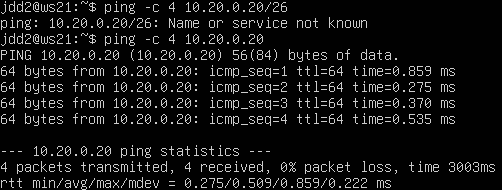
> Пинг `ws22` с `ws21`

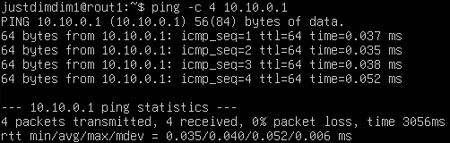
> Пинг `r1` с `ws11`

### 5.2. Включение переадресации IP-адресов
- Для включения переадресации `IP` выполним команду на роутерах:

        sysctl -w net.ipv4.ip_forward=1

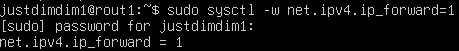
> Вывод команыд на машине `r1`

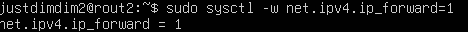
> Вывод команды на машине `r2`

- Открываем файл конфигурации с помощью команды:

        sudo nano /etc/sysctl.conf

- Добавляем в него следующую строчку

        net.ipv4.ip_forward=1

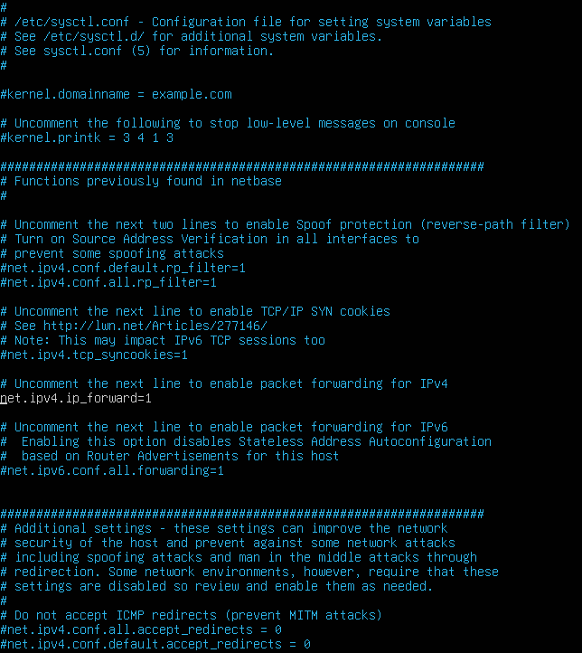
> Изменённый файл `/etc/sysctl.conf` на машине `r1`

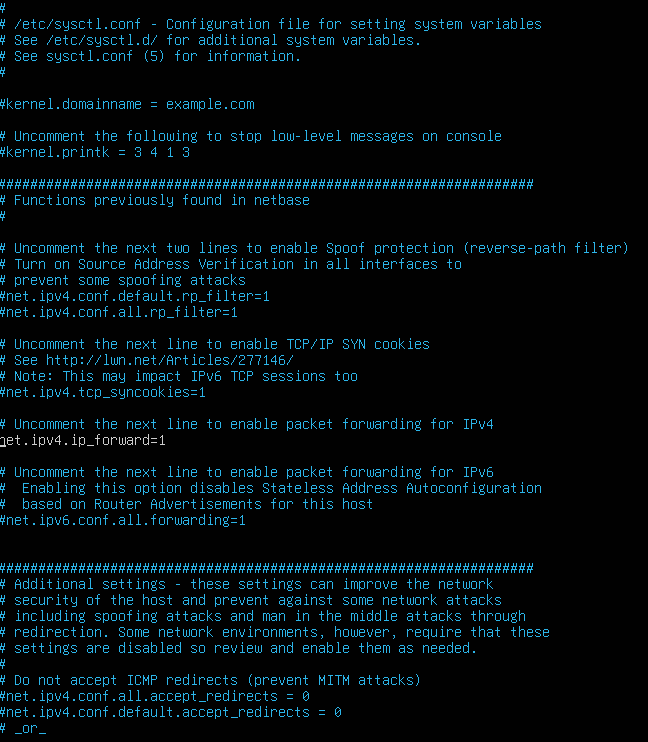
> Изменённый файл `/etc/sysctl.conf` на машине `r2`

### 5.3. Установка маршрута по умолчанию
- На каждой из рабочих машин заходим в файл конфигураций с помощью команды

        sudo nano etc/netplan/00-installer-config.yaml

- Настраиваем шлюз для рабочих станций

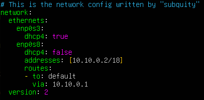
> Изменённый файл конфигурации на машине `ws11`

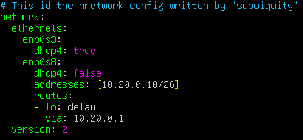
> Изменённый файл конфигурации на машине `ws21`

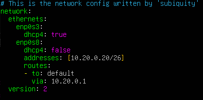
> Изменённый файл конфигурации на машине `ws22`

- Чтоб применить изменения используем команду:

        sudo netplan apply

- Проверяем, добавился ли маршрут в таблицу маршрутизации через команду:

        ip r

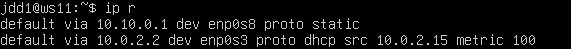
> Результат вызова команды `ip r` на машине `ws11`

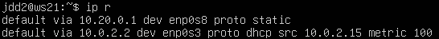
> Результат вызова команды `ip r` на машине `ws21`

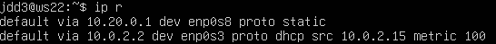
> Результат вызова команды `ip r` на машине `ws22`

- Пропингуем роутер `r2` с машины `ws11` с помощью команды:

        ping -c 3 10.100.0.12

> Пинг роутера `r2` с машины `ws11`

- Проверим, доходит ли пинг на `r2` c помощью команды:

        tcpdump -tn -i enp0s3

> Результат команды на машине `r2`

### 5.4. Добавление статистических маршрутов
- Добавим в роутеры статистические маршруты, изменив файл конфигурации с помощью команды:

        sudo nano /etc/netplan/00-installer-config.yaml

> Изменённый файл конфигурации в машине `r1`

> Изменённый файл конфигурации в машине `r2`

- С помощью команды `ip r` выедем таблицы с маршрутами на обоих роутерах

> Вывод команды `ip r` на машине `r1` (последние 3 строки - вывод типа, который в примере)

> Вывод команды `ip r` на машине `r2` (последние 3 строки - вывод типа, который в примере)

- На машине `ws11` запустим следующие команды:

        ip r list 10.10.0.0/18
        ip r list 0.0.0.0/0

> Результат данных команд на машине `ws11`

> Так как `ws11` входит в сеть `10.10.0.0/18`, то она использует собственный `ip` для свзи с ней. Однако, чтоб связаться с другими сетями, `ws11`пользуется маршрутом по умолчанию и отправляетс данные на роутер, чтоб он доставил их в нужную сеть

### 5.5. Построение списка маршрутизаторов
- На `r1` запустим команду дампа

        tcpdump -tnv -i enp0s8

> Вывод команды на машине `r1`

- Построим список маршрутизаторов на пути от `ws11` до `ws21`, используя команду:

        traceroute -n 10.20.0.10

> `-n` - без лишних наименований

> Вывод команды на машине `ws11`

> Вылавливаем трафик на машине `r1`, где уже происходит дамп

- `Traceroute` — это утилита, которая позволяет определить маршрут (список промежуточных узлов) до заданного хоста. В основе её работы лежит механизм `TTL` (Time To Live) в `IP`-пакетах и ответы `ICMP` от промежуточных маршрутизаторов. Основной принцип работы утилиты на моем примере:
    - `TTL=1` — `ws11` отправляет `UDP`-пакет с `TTL=1`, который доходит до `r1`, но в вашем дампе ответ от `r1` не виден (возможно, `ICMP` ушёл в другой интерфейс).
    - `TTL=2` — `ws11` отправляет пакет с `TTL=2`, который проходит `r1` и доходит до `r2`, где `TTL` становится `0`, и `r2` (`10.100.0.12`) отвечает `ICMP Time Exceeded`.
    - `TTL=3` — `ws11` отправляет пакет с `TTL=3`, который доходит до `ws21` (`10.20.0.10`), и `ws21` отвечает `ICMP Port Unreachable`, сигнализируя о достижении цели.
    - `Разные порты` — каждый пакет использует новый `UDP`-порт (`33440`, `33441`, `33442`,..), чтобы `traceroute` мог сопоставить ответ с конкретным `TTL`.
    - `Построение пути` — на основе этих `ICMP`-ответов `traceroute` на `ws11` строит маршрут: `r1` (`10.10.0.1`) → `r2` (`10.100.0.12`) → `ws21` (`10.20.0.10`).

### 5.6. Использование протокола ICMP при маршрутизации
- Запустим перехват сетевого трафика на машине `r1` с помощью команды:

        tcpdump -n -i enp0s3

> Перехват сетевого трафика на машине `r1`

- Пропингуем несуществующий `IP` на машине `ws11` с помощью команды:

        ping -c 1 10.30.0.111

> Пинг несуществующего `ip` - `10.3.0.111` на машине `ws11`

 

## Часть 6. Динамическая настройка IP с помощью DHCP
- Для использования dhcp нужно установить демон `dhcpd`. Его можно установить через определенный пакет, используя команду

        sudo apt-get install isc-dhcp-server

- На машине `r2` поменяем конфигурацию службы dhcp, используя команду:

        sudo nano /etc/dhcp/dhcpd.conf

> Изменённый конфигурационный файл на машине `r2`

- Затем меняем другой конфигурационный файл командой:
    
        sudo nano /etc/resolv.conf

> Измененный конфигурационный файл на машине `r2`

- На машине `r2` перезагрузим `DHCP` командой:

        sudo dystemctl restart isc-dhcp-server

- На машинах `ws21` и `ws22` активируем dhcp4, изменив конифгурационный файл:

        sudo nano etc/netplan/00-installer-config.yaml

> Изменённый конфигурационный файл на машине `ws21`

> Изменённый конфигурационный файл на машине `ws22`

- Перезапускаем операционные системы командой:

        sudo reboot

- Запустим команду:

        ip a

> Результат команды на машине `ws21`

> Результат команды на машине `ws22`

- Пропингуем `ws22` c `ws21` с помощью команды:
    
        ping -c 4 10.20.0.2

> Пинг `ws22` с `ws21`

- Задаём `MAC`-адрес для `ws11` с помощью изменения файла конфигурации

> Изменённый конфигурационный файл на машине `ws11`

- Проведем похожие изменения в коннфигурационных файлах на машине `r1`с помощью команды:

        sudo nano /etc/dhcp/dhcpd.conf
        sudo nano /etc/resolv.conf

> Изменения в `dhcp/dhcpd.conf`

> Изменения в `resolv.conf`

- Пропингуем `ws11` c `ws22`

> Пинг `ws11` с `ws22`

- Чтоб запросить обновление `ip`-адреса, нужно скачать новый пакет данных

        sudo apt install isc-dhcp-client -y

> `IP`-адреса до обновления на машине `ws21`

- Сначала удаляем старый адрес с помощью команды, а затем назначим новый адрес:

        sudo dhclient -r
        sudo dhclient -v

> Вывод выше упомянутых команд и `IP`-адресов после обновления

- В данном пункте были реализованы некоторые опци `GCPD`:
    - `option routers` указывает шлюз для клиентов `GCPD` по умолчанию
    - `option domain-name-servers` находитс `DNS`-серверы, которые клиентами будут использоваться дл разрешения имен в `IP`-адреса.
    - `option domain-name` задает имя домена по умолчанию, которым будут пользоваться клиенты `DHCP`

 

## Часть 7. NAT
- Для начала установим пакет `apache2` с помощью команды:

        sudo apt-get install apache2

- Изменим нужный конфигурационный файл на машинах `ws22` и `r1` с помощью команды:

        sudo nano /etc/apache2/ports.conf

> Изменённый конфигурационный файл на машине `ws22`

> Изменённый конфигурационный файл на машине `r1`

- Запустим веб-сервер `Apache` командой `service apache2 start` на машинах `ws22` и `r1` с помощью команды:

        sudo service apache2 start

- Затем проверим статус веб-сервера командой:

        sudo service apache2 status

> Результат указанных команд на машине `ws22`

> Результат указанных команд на машине `r1`

- Создадим файрволл на машине `r2` с помощью команды:

        sudo nano /etc/firewall.sh

> Файл файрволла на машине `r2`

- Затем запустим файл также, как и в [Части 4](#41-утилита-iptables)

> Запуск файла файрволла на машине `r2`

- Пингуем `ws22` с `r1`:

        ping -c 4 10.20.0.20

> Пинг `ws22` с `r1`

- Разрешаем маршрутизацию всех пакетов протокола `ICMP` с помощью изменения файла файрволла на машине `r2`:

        sudo nano /etc/firewall.sh

> Изменённый файл файрволла на машине `r2`

- Затем запускаем его, как в [Части 4](#41-утилита-iptables)

- Пропингуем `ws22` с `r1` с помощью команды:

        ping -c 4 10.20.0.20

> Пинг `ws22` с `r1`

- Включим `SNAT` и `DNAT` по соответствующим правилам, изменив файл файрволла на `r2`:

        sudo nano /etc/firewall.sh

> Изменённый файл файрволла на машине `r2`

- Затем запускаем его, как в [Части 4](#41-утилита-iptables)

- Проверим соединение по `TCP` для `SNAT`, используя на `ws22` команду:

        telnet 10.100.0.11 80

> Соединение по `TCP` для `SNAT`: подключение с `ws22` к серверу `Apache` на `r1`

- Проверим сединение по `TCP`для `DNAT`, используя на `r1` команду:

        telnet 10.100.0.12 8080

> Соединение по `TCP` для `DNAT`: подключение с `r1` к серверу `Apache` на `ws22`

 

## Часть 8. Дополнительно. Знакомство с SSH Tunnels
- Запускаем файрволл из [Части 7](#часть-7-nat), как в [Части 4](#41-утилита-iptables)

- Запускаем веб-сервер Apache на `ws22` только на `localhost`, изменив файл конфигурации на `ws22`:
        sudo nano /etc/apache2/ports.conf

> Изменённый файл конфигурации на `ws22`

> Проверка работы `apache2` на `ws22`

- Для того, чтоб мы воспользовались `Local TCP forwarding`, мы на `ws21` используем команду:

        ssh -L 8080:ws22:80 jdd3@10.20.0.20

> Результат работы команды на `ws21`

- На `ws22` проверим подключение командой:

        ps aux | gerp sshd

> Вывод команды на машине `ws22`

- Для того, чтоб мы воспользовались `Remote TCP forwarding`, мы на `ws11` используем команду:

        ssh -R 8080:10.20.0.10:80 jdd1@localhost

> Результат работы команды на `ws11`

- Затем для проверки работы подключения в обоих предыдущих пунктах сначала переходим во второй терминал сочетанием клавиш:

        Alt+F2

- Затем выполняем команду:

        telnet 127.0.0.1 8080

> Результат работы команды на `ws11` (на втором терминале)